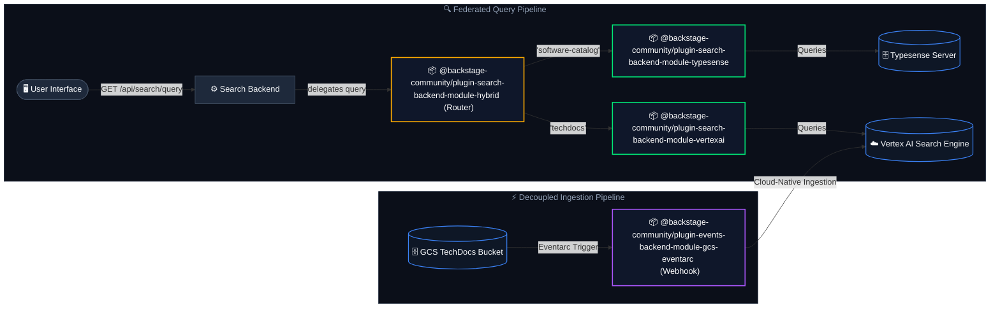

# Hybrid Search Workspace (`workspaces/hybrid-search`)

This workspace hosts a modular hybrid search architecture for Backstage. It allows routing queries to different search engines (such as Vertex AI, Typesense, or others) in parallel based on the requested categories, and dynamically merging the search results into a single unified search experience.

---

## 🏛️ High-Level Architecture

The workspace implements a **Federated Hybrid Search** pipeline. Queries from the user interface are handled by the hybrid engine router, which splits the query across different search systems (engines) in parallel based on the requested document categories (types), then merges the results.



---

### 🔌 Deployment Modes

Each search engine module in this workspace is designed to be highly flexible and can be deployed in one of two modes:

1. **Standalone Mode (Primary Engine)**: The search module is registered directly as the primary search engine for Backstage (replacing default engines like Lunr). All query execution and indexing flow directly through it.
2. **Hybrid Mode (Federated Search)**: The [Hybrid Search Engine Router](./plugins/search-backend-module-hybrid/README.md) is registered as the primary search engine, and delegates queries to multiple sub-engines (like Typesense and Vertex AI Search) in parallel based on the requested categories, merging the results dynamically.

---

## 📦 Workspace Plugins & Modules

This workspace contains four specialized plugins:

| Plugin / Module                    | Directory                                                                                              | Purpose                                                                                                                                                                                                                                                                                                                                                                  |
| :--------------------------------- | :----------------------------------------------------------------------------------------------------- | :----------------------------------------------------------------------------------------------------------------------------------------------------------------------------------------------------------------------------------------------------------------------------------------------------------------------------------------------------------------------- |
| **Hybrid Search Engine Router**    | [`plugins/search-backend-module-hybrid`](./plugins/search-backend-module-hybrid/README.md)             | The core router that delegates queries to registered sub-engines in parallel based on document categories, then aggregates and interleaves the results.                                                                                                                                                                                                                  |
| **Typesense Search Engine Module** | [`plugins/search-backend-module-typesense`](./plugins/search-backend-module-typesense/README.md)       | Integrates Typesense search capabilities into Backstage. Can be deployed as a standalone primary search engine or registered as a sub-engine to the Hybrid Router. Handles active document ingestion and query mapping for any standard/custom document types.                                                                                                           |
| **Vertex AI Search Engine Module** | [`plugins/search-backend-module-vertexai`](./plugins/search-backend-module-vertexai/README.md)         | Integrates Google Cloud Vertex AI Search into Backstage. Can be deployed as a standalone primary search engine or registered as a sub-engine to the Hybrid Router. Translates queries to Discovery Engine API requests and manages background catalog cleanup.                                                                                                           |
| **GCS Eventarc Ingestion Webhook** | [`plugins/events-backend-module-gcs-eventarc`](./plugins/events-backend-module-gcs-eventarc/README.md) | Cloud-native webhook ingress that listens to GCS file creation events via Google Eventarc to trigger incremental ingestion into Vertex AI Search. This decouples documentation publication from the Backstage backend, allowing instant indexing of TechDocs built via external CI/CD pipelines (e.g. using `techdocs-cli`) with zero local Node.js CPU/memory overhead. |

---

## ⚙️ Quick Start Configuration

To configure the workspace routing and sub-engines in your `app-config.yaml`:

```yaml
search:
  engines:
    hybrid:
      # Optional: 'interleave' (default) or 'score-normalized-sort'
      mergeStrategy: score-normalized-sort
      routing:
        software-catalog: typesense
        techdocs: vertexai
        default: typesense # Fallback for unmapped categories
    typesense:
      apiKey: ${typesenseApiKey}
      nodes:
        - host: localhost
          port: 8108
          protocol: http
      collections:
        software-catalog:
          fields:
            - name: '.*'
              type: 'auto'
          searchOptions:
            query_by: 'title,text,location'
    vertexai:
      types:
        techdocs:
          datastore:
            projectId: ${projectId}
            datastoreId: ${dataStoreId}
            location: ${location}
          # Optional: Search App Engine ID. If specified, queries will target the Engine serving config
          # rather than the standalone data store serving config, enabling advanced search features.
          engine:
            projectId: ${projectId}
            engineId: ${engineId}
            location: ${location}
          # Optional: Raw search client query options (e.g. summary answers / spell corrections)
          searchOptions:
            contentSearchSpec:
              snippetSpec:
                maxSnippetCount: 1
      cleanup:
        enabled: true
        frequency: { hours: 2 }
```

---

## 🔌 Installation & Backend Integration

To register the Hybrid Search Engine and its modules in your Backstage backend instance, add them to your `packages/backend/src/index.ts` file:

```typescript
// packages/backend/src/index.ts
import { createBackend } from '@backstage/backend-defaults';

const backend = createBackend();

// ... other plugins/modules ...

// 1. Add the Hybrid search engine orchestrator
backend.add(import('@backstage-community/plugin-search-backend-module-hybrid'));

// 2. Add the sub-engine modules you wish to register (using their hybrid entry points)
backend.add(
  import('@backstage-community/plugin-search-backend-module-typesense/hybrid'),
);
backend.add(
  import('@backstage-community/plugin-search-backend-module-vertexai/hybrid'),
);

// 3. (Optional) Add the companion ingestion webhook module if using Vertex AI Search
backend.add(
  import('@backstage-community/plugin-events-backend-module-gcs-eventarc'),
);

backend.start();
```

---

## 🛠️ Development & Commands

Run all command scripts from the root directory of this workspace:

### Install Workspace Dependencies

```bash
yarn install
```

### Run All Unit and Integration Tests

```bash
yarn test --watch=false
```

### Compile & Build All Packages

```bash
yarn build:all
```

### Generate and Verify API Reports

```bash
yarn build:api-reports
```
