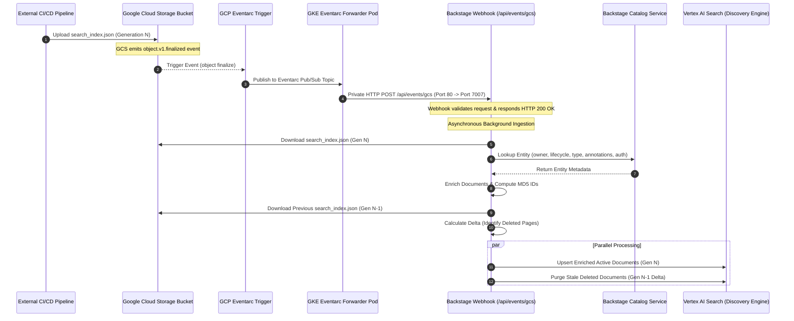

# Master Architecture & Technical Specification: Hybrid Search Workspace

**Document Version**: 1.0.0  
**Target Architecture**: Backstage New Backend System (`@backstage/backend-plugin-api`)  
**Workspace**: `workspaces/hybrid-search`

---

## Executive Summary

The **Hybrid Search Workspace** provides a federated multi-engine query router and decoupled asynchronous ingestion pipeline for Backstage developer portals. In modern enterprise developer portals, search demands vary dramatically across document categories: catalog entity lookups require high-throughput exact metadata matching, whereas technical documentation search requires deep semantic comprehension and long-form prose indexing. Standard single-engine Backstage deployments force operators into a compromise, routing all queries through a single search datastore and executing resource-intensive pull ingestion streams directly inside the Node.js web server process.

The Hybrid Search Workspace resolves these architectural trade-offs by introducing:

1. **Federated Query Orchestration**: A top-level search router engine that intercepts incoming search queries, maps document types to specialized search backends (such as Typesense for structured catalog lookups and Google Cloud Vertex AI Search for semantic documentation search), dispatches queries concurrently in parallel, and merges search results using configurable relevance strategies.
2. **Decoupled Asynchronous Ingestion**: A cloud-native event-driven ingestion model that offloads TechDocs site compilation and document parsing from the Node.js runtime to external CI/CD pipelines and cloud object storage (Google Cloud Storage), triggering instant webhook ingestion via Google Cloud Eventarc with live catalog metadata enrichment and automatic delta reconciliation.

This master architecture document serves as the comprehensive technical reference and operational manual for platform architects, software engineers, and DevOps leads. It is organized into four distinct parts:

- **Part 1: How Backstage Search Works (Conceptual & Architectural Analysis)** — A first-principles analysis of core Backstage search abstractions, query and stream mechanics, and fundamental architectural limitations of standard deployments.
- **Part 2: Value Proposition & Technical Mechanics of Hybrid Search (Conceptual Analysis)** — A conceptual breakdown of federated multi-engine routing, parallel dispatch, result score merging, decoupled ingestion, catalog enrichment, and MD5 delta reconciliation.
- **Part 3: System Architecture & Package Specifications (Conceptual Breakdown & Diagrams)** — A structural analysis of workspace packages, runtime conflict rules, deployment topologies (standalone vs. federated hybrid), and sequence flow diagrams.
- **Part 4: Complete Operator & Implementation Manual (Low-Level Configuration & Code)** — Low-level backend module TypeScript registration, annotated `app-config.yaml` manifests, Kubernetes service port mappings, GCP IAM role matrices, Terraform infrastructure, network security runbooks, and local testing procedures.

---

## Document Overview & Structural Map

```
┌───────────────────────────────────────────────────────────────────────────────────┐
│              Master Architecture Document Structure & Navigation                  │
├───────────────────────────────────────────────────────────────────────────────────┤
│  Part 1: How Backstage Search Works (Conceptual Analysis)      [Active - Task 1] │
│  ├── Section 1: Core Architecture & Extension Points                              │
│  ├── Section 2: Query & Ingestion Execution Mechanics                             │
│  └── Section 3: Four Fundamental Architectural Limitations                        │
├───────────────────────────────────────────────────────────────────────────────────┤
│  Part 2: Value Proposition & Technical Mechanics               [Upcoming - Task 2]│
├───────────────────────────────────────────────────────────────────────────────────┤
│  Part 3: System Architecture & Package Specifications          [Upcoming - Task 3]│
├───────────────────────────────────────────────────────────────────────────────────┤
│  Part 4: Complete Operator & Implementation Manual             [Upcoming - Task 4]│
└───────────────────────────────────────────────────────────────────────────────────┘
```

---

# Part 1: How Backstage Search Works (Conceptual & Architectural Analysis)

---

## Section 1: Backstage Search Core Architecture & Extension Points

To understand why a federated hybrid architecture is required, it is essential to first understand how the standard upstream Backstage search system operates. Backstage organizes search capabilities into a centralized search backend plugin (`@backstage/plugin-search-backend`) and a shared node library (`@backstage/plugin-search-backend-node`). Together, these packages provide an extensible abstraction framework for document ingestion and query processing across developer portal assets.

### 1. First-Principles Breakdown of Core Abstractions

Backstage search decomposes document discovery into five primary architectural abstractions:

#### A. `SearchEngine`

The `SearchEngine` interface represents the foundational contract between the generic Backstage search backend and a specific underlying search technology (such as Lunr, Elasticsearch, Postgres, Typesense, or Google Cloud Vertex AI Search).

The `SearchEngine` abstraction is responsible for three distinct operational duties:

1. **Query Translation & Execution**: Intercepting generic Backstage search query contracts and translating them into engine-specific query DSLs, database calls, or REST API payloads. It executes the query against the backend datastore and converts engine-native response payloads back into standard Backstage result objects.
2. **Indexer Creation**: Producing writable stream instances (`SearchEngineIndexer`) that receive indexed document payloads during ingestion pipelines and batch-write them into the underlying search index or database table.
3. **Index Management**: Handling schema provisioning, index initialization, and optional document deletion routines for specific document categories.

By insulating the rest of the portal from engine-specific query languages and index storage schemas, `SearchEngine` allows Backstage to remain engine-agnostic at its core layer.

#### B. `SearchEngineRegistry`

The `SearchEngineRegistry` acts as the extension point and central registry for search engine implementations within the Backstage backend system. During application initialization, backend modules register search engine instances with this registry.

Under standard Backstage architecture, `SearchEngineRegistry` manages engine resolution for the portal:

- It maintains a reference to the active primary search engine instance.
- It exposes lookup mechanisms for the search backend services to retrieve the registered engine during HTTP query handling and ingestion pipeline construction.

#### C. `IndexBuilder`

The `IndexBuilder` is the orchestration engine for document ingestion pipelines within the Backstage process. It acts as a builder class where developers and plugins register document sources (Collators) and document transformers (Decorators).

When triggered, `IndexBuilder` constructs end-to-end Node.js streaming pipelines:

- It connects readable collator streams to zero or more transform decorator streams.
- It pipes the final transformed document stream into the writable indexer stream provided by the registered `SearchEngine`.
- It manages pipeline lifecycle events, monitoring stream completion, backpressure, and pipeline error states.

#### D. `Scheduler`

The `Scheduler` is the background task orchestration service responsible for triggering periodic document ingestion jobs. In standard Backstage installations, search indexing is not real-time or event-driven; instead, it relies on time-based polling.

The `Scheduler` operates according to defined time intervals or cron expressions:

- It schedules recurrent background tasks for each registered document type (e.g., reindexing component catalog entities every 30 minutes, or reindexing documentation pages every hour).
- It executes task runners that invoke `IndexBuilder` streaming pipelines.
- In multi-replica Backstage deployments, it coordinates distributed task execution using database locks to prevent redundant concurrent indexing runs across portal backend instances.

#### E. `Collators`

A `Collator` is a specialized Readable Stream factory responsible for harvesting indexable content from upstream source systems and converting that content into standardized Backstage `IndexableDocument` objects.

Examples of standard collators include:

- **Catalog Collator (`DefaultCatalogCollatorFactory`)**: Queries the Backstage Software Catalog microservice to pull software entities (components, systems, domains, APIs, templates, locations), extracting metadata such as entity names, descriptions, owners, lifecycles, and tags.
- **TechDocs Collator (`DefaultTechDocsCollatorFactory`)**: Crawls compiled technical documentation sites stored in object storage buckets (or local disk), parsing compiled `search_index.json` manifests to extract page titles, text headers, section paragraphs, and canonical doc URIs.

Each collator encapsulates the logic required to authenticate with, read from, and paginate through its target upstream data source.

---

## Section 2: Standard Query & Ingestion Execution Mechanics

Understanding the operational runtime mechanics of standard Backstage search requires tracing two fundamental data paths: the synchronous HTTP Query Lifecycle and the asynchronous Pull-Indexing Stream Pipeline.

### 1. Synchronous Query Lifecycle (`GET /api/search/query`)

When a developer enters a search query into the Backstage portal user interface, the request executes through a synchronous HTTP lifecycle managed by the search backend plugin:

```
[ Backstage Search UI ]
          │
          │ 1. HTTP GET /api/search/query?term=auth&types[]=software-catalog&types[]=techdocs
          ▼
[ Search Backend Plugin Router ]
          │
          │ 2. Read parameters & resolve primary engine from SearchEngineRegistry
          ▼
[ Primary SearchEngine Implementation ]
          │
          │ 3. Translate SearchQuery into Engine DSL / API Payload
          ▼
[ Engine Datastore / Search Service ] (e.g., Lunr, Elasticsearch, Postgres)
          │
          │ 4. Execute Search & Return Native Match Payload
          ▼
[ Response Normalization Layer ]
          │
          │ 5. Convert Native Matches into Standard SearchResult Array
          ▼
[ Backstage Search UI ] (Renders unified result list with highlights)
```

#### Step-by-Step Query Execution Flow:

1. **HTTP Ingress**: The frontend component issues an HTTP `GET` request to the search backend endpoint `/api/search/query`. The query parameters encode search terms (e.g., `term=auth`), category filters (e.g., `types[]=software-catalog`), structural filters (e.g., `filters[kind]=Component`), pagination offsets, and page size limits.
2. **Request Resolution**: The search backend plugin parses the request context, validates authorization tokens, and retrieves the registered `SearchEngine` instance from the `SearchEngineRegistry`.
3. **Query Translation**: The `SearchEngine` implementation receives a standard `SearchQuery` object containing terms, filters, and pagination parameters. The engine translates these generic abstractions into its native query syntax (such as Elasticsearch JSON query DSL, SQL queries for Postgres, or Lunr term objects).
4. **Index Execution**: The search engine executes the query against its target datastore or remote search cluster.
5. **Response Normalization**: The raw search response (containing match hits, relevance scores, and text snippet highlights) is converted into Backstage's standardized `SearchResult` payload structure.
6. **HTTP Egress**: The search backend responds to the client with JSON containing the normalized result items, total result counts, and pagination tokens (`pageCursor`).

---

### 2. Standard Pull-Indexing Stream Mechanics (`Collator → Decorators → Indexer`)

Document ingestion in standard Backstage operates as an in-memory, stream-based pull pipeline running inside the Node.js backend process:

```
┌────────────────────────────────────────────────────────────────────────────────────────────────┐
│ Backstage Backend Process (Node.js Event Loop Memory)                                          │
│                                                                                                │
│ ┌──────────────────────┐     ┌───────────────────────┐     ┌─────────────────────────────────┐ │
│ │  Collator (Readable) │     │ Decorators (Transform)│     │   SearchEngineIndexer (Writable)│ │
│ │                      │     │                       │     │                                 │ │
│ │ Pulls raw items from │────>│ Enriches doc fields,  │────>│ Batches & writes documents into │ │
│ │ Catalog / TechDocs   │     │ adds auth/meta tags   │     │ target search datastore index   │ │
│ └──────────────────────┘     └───────────────────────┘     └─────────────────────────────────┘ │
└────────────────────────────────────────────────────────────────────────────────────────────────┘
```

#### Step-by-Step Ingestion Stream Execution Flow:

1. **Scheduler Trigger**: The background `Scheduler` fires a scheduled indexing job based on the configured timer interval for a specific document type.
2. **Pipeline Assembly**: The `IndexBuilder` instantiates the registered `Collator` readable stream, constructs any registered `Decorator` transform streams, and requests a writable `SearchEngineIndexer` stream from the active `SearchEngine`.
3. **Stream Pipe Setup**: `IndexBuilder` pipes the streams together: `Collator.pipe(Decorator_1).pipe(Decorator_N).pipe(Indexer)`.
4. **Data Pulling & Emission**: The `Collator` issues network requests to its upstream source (e.g., fetching catalog entity pages from the Catalog microservice) and emits `IndexableDocument` objects down the pipeline.
5. **Transformation & Enrichment**: As documents pass through transform `Decorators`, additional attributes are appended or modified (such as decorating documents with RBAC security tags, canonical link URLs, or tenant identifiers).
6. **Batch Writing**: The `SearchEngineIndexer` receives decorated document objects, buffers them into memory batches (e.g., 100 documents per batch), and executes batch write operations into the target search datastore or index table.
7. **Stream Finalization**: Once the `Collator` reaches the end of its upstream dataset, it closes the readable stream. The pipeline flushes remaining in-memory batches, closes the indexer, and signals task completion to the `Scheduler`.

---

## Section 3: Four Fundamental Architectural Limitations of Standard Backstage Deployments

While standard Backstage search provides a simple baseline for small portal installations, analyzing its runtime behavior reveals four fundamental architectural limitations that severely impact scalability, search relevance, operational stability, and index freshness in production environments.

### 1. Single Search Engine Constraint in Backend Core

#### Architectural Limitation:

The standard Backstage core search backend (`@backstage/plugin-search-backend`) enforces a strict single-engine registration pattern. The core `SearchEngineRegistry` design assumes that one, and only one, `SearchEngine` instance handles all search capabilities for the entire developer portal. If a second search engine module attempts to register itself during backend initialization, the core system throws a fatal startup exception. Furthermore, standard Backstage core possesses zero native routing logic to inspect document types or direct requests to distinct engines based on query intent.

#### Practical Impact & Consequence:

This rigid constraint forces platform teams into a single-datastore compromise across fundamentally heterogeneous data domains:

- **Catalog Metadata vs. Documentation Prose**: Software catalog entries consist of short, highly structured metadata attributes (component names, team owners, lifecycle tags, system boundaries) where exact keyword matching and fast prefix filtering are critical. Conversely, technical documentation consists of unstructured, long-form markdown prose, conceptual guides, and architecture manuals where semantic search, synonym expansion, and vector embeddings yield far superior discovery.
- **Forced Infrastructure Trade-Offs**: If operators choose a fast keyword engine (such as Typesense or Lunr), catalog lookups perform exceptionally well, but documentation search fails to return relevant results for conceptual or semantic queries. If operators choose a vector/LLM-powered engine or cloud discovery service (such as Google Cloud Vertex AI Search), prose documentation search excels, but exact catalog entity lookups can suffer from semantic hallucination or lower precision on exact component names.
- **Inability to Leverage Specialized Engines**: Organizations are unable to route team directory queries to LDAP/Active Directory indices, code snippets to specialized code search engines, and component entities to lightweight key-value stores—all because core Backstage limits the entire portal to a single monolithic engine interface.

---

### 2. Single-Process Stream Bottlenecks & V8 Heap Memory Strain

#### Architectural Limitation:

In standard Backstage deployments, document ingestion pipelines (`Collator → Decorators → Indexer`) execute directly inside the primary Node.js web server process. Parsing, transforming, and streaming thousands of complex documentation pages or catalog entities occurs synchronously within the same single-threaded V8 JavaScript event loop that handles user HTTP traffic.

#### Practical Impact & Consequence:

- **Node.js Event Loop Starvation**: Large-scale TechDocs indexing requires fetching compiled `search_index.json` files, unpacking HTML string structures, executing regex text sanitization, stripping code blocks, and instantiating thousands of JavaScript document objects. This heavy CPU-bound parsing blocks the single-threaded Node.js event loop. As a result, concurrent user HTTP requests to the portal experience severe latency spikes, delayed responses, or request timeouts during indexing cycles.
- **V8 Heap Memory Pressure & Out-Of-Memory (OOM) Crashes**: Standard Node.js processes operate under strict default V8 heap memory limits (typically 2GB to 4GB). When an organization scales to thousands of microservices and documentation sites, streaming large document payloads into memory buffers causes extreme heap expansion. High memory consumption triggers frequent, long-duration V8 garbage collection (GC) pauses, further freezing the server. Under heavy reindexing loads, the backend process frequently exceeds V8 memory limits and crashes with `ERR_STRING_TOO_LONG` or `FATAL ERROR: Reached heap limit Allocation failed - JavaScript heap out of memory`.
- **Blast Radius & System Instability**: Because search ingestion shares process memory with core portal capabilities (such as Software Catalog navigation, TechDocs rendering, and Scaffolder workflow execution), a heavy search reindex job can crash the entire portal backend, causing widespread downtime for all portal users.

---

### 3. Monolithic Query Translation & Uniform Relevance Scoring

#### Architectural Limitation:

Because standard Backstage routes all query requests to a single `SearchEngine` datastore, queries spanning multiple document categories (e.g. searching across both `software-catalog` entities and `techdocs` pages simultaneously) are subjected to a monolithic query translation scheme. The backend engine translates user search terms using a single, uniform set of tokenization, stemming, scoring, and ranking rules across all document indices.

#### Practical Impact & Consequence:

- **Incompatible Scoring Metrics**: Structured metadata entities and unstructured documentation prose evaluate relevance using opposing scoring dynamics:
  - Catalog entities rely on exact field matches (e.g. `name: "auth-service"`, `kind: "Component"`). A single matching token in a short entity name represents massive relevance density.
  - TechDocs prose pages rely on document-length normalized metrics (such as BM25 or TF-IDF), where keyword density across long paragraphs determines document relevance.
- **Relevance Distortion & Card Pollution**: When a unified search query executes against a monolithic datastore index containing both entity types, standard relevance algorithms fail to normalize scores across domains. Long-form documentation pages with frequent term repetitions often skew BM25 scores upward, completely overwhelming exact catalog entity matches. As a result, page 1 of user search results becomes polluted with obscure documentation sections while the exact target component entity is buried on page 3.
- **Lack of Category Boosting & Custom Normalization**: Standard monolithic translation prevents operators from applying fine-grained boosting rules tailored to specific document types. Operators cannot specify that entity name matches should carry 10x boosting weight over documentation text matches within the same query without breaking scoring semantics for documentation queries.

---

### 4. Scheduled Polling Delays & Lack of Delta Reconciliation

#### Architectural Limitation:

Standard Backstage ingestion relies strictly on timer-based polling (`Scheduler`). Document updates published in developer CI/CD pipelines must wait for the next scheduled cron poll interval before appearing in search results. More critically, standard pull-stream collators and indexers process datasets strictly as append/overwrite operations; they possess zero architectural capability to compute historical deltas between current ingestion runs and past index states.

#### Practical Impact & Consequence:

- **Indexing Delays & Stale Documentation**: When a developer updates technical documentation or catalog metadata in Git and merges a pull request, the changes are compiled and published immediately by CI/CD. However, because standard Backstage search relies on periodic `Scheduler` polling (which may run every 1 to 6 hours to minimize CPU strain), there is a significant temporal lag between publication and searchability. Developers searching for recently updated API specs or deployment guides are presented with outdated search results.
- **Orphaned Index Records ("Ghost Results")**: When a component is deleted from the catalog, or when documentation markdown files are renamed or removed in Git during repository restructuring, standard pull pipelines emit only the _currently existing_ documents. Because standard indexers do not track historical index state or compare generation `N` against generation `N-1`, deleted documents are never explicitly purged from the target search engine.
- **Accumulation of Broken Search Hits**: These deleted pages become permanent "orphaned" or "ghost" records in search indices. When users click on these orphaned search result cards, they are navigated to HTTP 404 pages. The only way to eliminate orphaned records in standard Backstage deployments is to execute a manual, destructive full-index wipe and rebuild—an operational task that causes search downtime and heavy infrastructure load.

---

# Part 2: Value Proposition & Technical Mechanics of Hybrid Search (Conceptual Analysis)

---

## Section 1: Federated Multi-Engine Search Routing & Engine Specialization

The core architectural solution to the limitations of standard Backstage search is **Federated Multi-Engine Routing**. Rather than forcing all portal document categories into a single, uniform search datastore, the Hybrid Search Architecture introduces a dynamic query orchestrator (`HybridSearchEngine`) that intercepts incoming search requests, evaluates document category filters, dispatches queries to domain-specialized sub-engines, and consolidates the results into a unified response.

### 1. The Principle of Categorical Query Routing

In a developer portal, incoming search queries convey explicit or implicit intent through document category filters (represented by the `types` query parameter in the Backstage search contract, such as `types[]=software-catalog` or `types[]=techdocs`).

The Hybrid Search Router operates a categorical routing matrix configured via application settings (`routing` map):

- **Targeted Single-Engine Routing**: When an incoming request contains a `types` array matching a single designated backend engine (e.g., `types: ['software-catalog']` mapped to Typesense), the router skips multi-engine federation. It forwards the request directly to the target sub-engine, preserving native engine features such as deep cursor-based pagination and specialized field filtering.
- **Federated Parallel Multi-Engine Routing**: When a search query specifies multiple category types (e.g., `types: ['software-catalog', 'techdocs']`) or omits the `types` parameter altogether (representing a global, portal-wide search query), the router broadcasts the query across all relevant sub-engines in parallel.

> [!NOTE] > **First-Principles Concept — Federated Routing**:
> Federated routing is a software architecture pattern where a top-level gateway or orchestrator delegates execution to specialized, autonomous downstream services rather than executing queries against a single monolithic datastore. The client interacts with a single unified interface, while the backend orchestrator handles query fan-out, backend translation, and result aggregation.

### 2. Engine Specialization Rationale

A fundamental premise of the Hybrid Search Workspace is that different developer portal assets possess radically different structural characteristics, query patterns, and discovery requirements.

```
┌─────────────────────────────────────────────────────────────────────────────────────────────┐
│                            Domain Engine Specialization Matrix                              │
├───────────────────────────────────────┬─────────────────────────────────────────────────────┤
│     Structured Catalog Entities       │             │  Unstructured Technical Documentation │
├───────────────────────────────────────┼─────────────────────────────────────────────────────┤
│ • Compact JSON Key-Value Schemas      │             │ • Long-Form Markdown Prose & Guides   │
│ • Exact Keyword & Prefix Matching     │             │ • Conceptual & Natural Language Intent│
│ • Low-Latency Faceted Filtering       │             │ • Semantic Embeddings & Neural Vector │
├───────────────────────────────────────┼─────────────────────────────────────────────────────┤
│    Typesense Search Engine            │             │  Google Cloud Vertex AI Search        │
│    (C++ In-Memory / Low-Latency)      │             │  (Discovery Engine / Vector LLM)      │
└───────────────────────────────────────┴─────────────────────────────────────────────────────┘
```

#### A. Typesense for Structured Catalog Entities

- **Data Characteristics**: The Backstage Software Catalog consists of highly structured microservice metadata: component names, team ownership, lifecycle states, system domains, and technical tags. These documents are short, field-centric JSON structures.
- **Query Patterns**: Developers searching the catalog typically expect exact string matching, prefix autocompletion (e.g., typing `auth-serv` to find `auth-service`), and strict key-value filtering (e.g., filtering for `kind: Component` and `spec.lifecycle: production`).
- **Engine Selection Mechanics**: Typesense is a lightweight, open-source C++ search engine optimized for fast in-memory indexing, typotolerant keyword lookups, and sub-10 millisecond response times. It excels at exact token matching and metadata filtering without the memory overhead of enterprise JVM search engines or the semantic ambiguity of vector models.

#### B. Google Cloud Vertex AI Search for Semantic Technical Documentation

- **Data Characteristics**: Technical documentation (TechDocs) consists of long-form, multi-paragraph markdown prose, architectural decision records (ADRs), installation guides, and API tutorials.
- **Query Patterns**: Developers searching documentation often formulate natural language questions (e.g., "how do I configure OAuth2 token refresh?") or use conceptual terminology that differs from the exact words written by the documentation author (vocabulary mismatch).
- **Engine Selection Mechanics**: Google Cloud Vertex AI Search (Discovery Engine) leverages advanced Google Large Language Models (LLMs) and neural vector embeddings to perform semantic search. It understands conceptual context beyond raw keyword matching, automatically generates extractive answers and snippets from prose text, and tolerates natural language variation across long-form documents.

### 3. Federated Query Dispatch Workflow & Decision Architecture

The following diagram illustrates how the `HybridSearchEngine` intercepts incoming HTTP queries, evaluates request parameters against the routing matrix, executes parallel or targeted dispatch, and returns consolidated results:

```mermaid
flowchart TD
    Client([Backstage Client / UI]) -->|"GET /api/search/query?term=auth&types[]=..."| Router[Search Backend Plugin]
    Router -->|SearchQuery| HybridEngine[Hybrid Search Engine Router]

    HybridEngine --> CategoryCheck{Evaluate Request 'types'}

    CategoryCheck -->|"Single Type (e.g., software-catalog)"| SinglePath[Targeted Single-Engine Dispatch]
    SinglePath -->|Direct Query| TypesenseEngine[Typesense Sub-Engine]
    TypesenseEngine -->|Native Results + Cursor| Client

    CategoryCheck -->|"Multiple Types OR Empty [] (Global Search)"| FederatedPath[Federated Multi-Engine Fan-Out]

    FederatedPath -->|Parallel Promise.allSettled| EngA[Typesense Sub-Engine\n(Catalog Entities)]
    FederatedPath -->|Parallel Promise.allSettled| EngB[Vertex AI Search Sub-Engine\n(TechDocs Prose)]

    EngA -->|Catalog Hits| Aggregator[Result Merging & Score Aggregator]
    EngB -->|TechDocs Hits| Aggregator

    Aggregator -->|Apply Strategy: interleave OR score-normalized-sort| Consolidated[Consolidated Result Array]
    Consolidated -->|Slice to Page Limit & Omit Cursor| Router
    Router -->|JSON SearchResultResponse| Client
```

---

## Section 2: Fault Isolation & Parallel Execution Mechanics

In a federated multi-engine architecture, querying downstream search backends over network links introduces risk: a single slow remote service or network failure could block or crash the entire search experience. The Hybrid Search Workspace addresses this risk through **Parallel Execution** and **Fault Isolation**.

### 1. Asynchronous Parallel Dispatch (`Promise.allSettled`)

When a global search query requires querying multiple search backends, executing requests sequentially (awaiting Engine A, then awaiting Engine B) would result in additive latency ($T_{\text{total}} = T_A + T_B$). To maximize responsiveness, the hybrid router dispatches queries concurrently across all mapped sub-engines. Total execution time is bounded by the slowest responding sub-engine ($\max(T_A, T_B)$) rather than the sum of latencies.

Crucially, the router manages concurrent sub-engine dispatches using a resilient aggregation pattern (`Promise.allSettled`) rather than a strict fail-fast pattern (`Promise.all`):

- **Fail-Fast Pattern (`Promise.all`)**: If any single sub-engine fails (e.g., due to a temporary network timeout or API rate limit), the entire promise rejects immediately. The portal search API responds with an HTTP 500 error, completely denying search results to the developer.
- **Resilient Aggregation Pattern (`Promise.allSettled`)**: The router collects the settlement state (either fulfilled with data or rejected with an error) of each sub-engine independently. If one backend fails, the router captures and logs the error, suppresses the isolated failure, and continues processing the fulfilled responses from the remaining backends.

> [!TIP] > **Operational Resiliency Impact**:
> If Google Cloud Vertex AI Search experiences an API interruption or quota restriction, a global search query will still succeed and immediately return catalog entity matches from Typesense. The developer receives partial, relevant results rather than an error page, ensuring high system availability.

### 2. Sub-Engine Timeout Isolation & Latency Budgeting

To prevent a degraded or unresponsive sub-engine from hanging the user's search request, the hybrid router enforces individual timeout isolation circuit breakers around every sub-engine invocation.

1. **Latency Budget Assignment**: Each sub-engine call is allocated a strict maximum response deadline (e.g., 2000 milliseconds).
2. **Abortion Signal**: If a sub-engine does not fulfill its request within the allocated deadline, the router cancels the pending request context locally and marks that specific engine's promise as rejected due to timeout.
3. **Blast Radius Minimization**: Fast local or in-cluster engines (such as a local Typesense cluster responding in 5ms) are completely shielded from latency spikes occurring in remote cloud APIs across WAN links. The user receives fast results from healthy engines without waiting for stalled backends.

---

## Section 3: Result Aggregation & Score Merging Mechanics

When a federated search query returns separate match arrays from multiple sub-engines, the hybrid router must consolidate these distinct payloads into a single, ordered result list for rendering in the developer portal interface.

### 1. The Heterogeneous Result Consolidation Problem

Directly merging results from heterogeneous search engines presents a fundamental scoring challenge: **incommensurate scoring scales**.

- **Typesense** computes keyword relevance scores using integer-based BM25/frequency metrics that often range from tens to hundreds (e.g., scores of `150` to `850`).
- **Vertex AI Search** evaluates semantic vector similarity using normalized probabilistic floats bounded between `0.0` and `1.0` (or returns raw extractive rank orderings without explicit numerical scores).

If a router simply concatenated raw results and sorted by raw score, Typesense hits would perpetually overwhelm Vertex AI Search hits, permanently burying documentation search results regardless of their actual relevance. To resolve this, the Hybrid Search Workspace provides two configurable result merging strategies.

### 2. Merging Strategy 1: Round-Robin Interleaving (`interleave`)

Round-Robin Interleaving is the default merging strategy (`mergeStrategy: interleave`). It consolidates result lists by sequentially selecting items from each sub-engine array in alternating order (e.g., Position 0: Engine A Item 0; Position 1: Engine B Item 0; Position 2: Engine A Item 1; Position 3: Engine B Item 1, and so on).

- **Mechanics**: The router maintains cursor pointers across each engine's returned result set, popping items in round-robin sequence until the global page limit is satisfied or all result sets are exhausted.
- **Architectural Rationale**: Interleaving is engine-agnostic and ignores underlying numerical scores entirely. It guarantees equal visual representation on Page 1 of search results for both catalog entities and documentation pages.
- **Primary Use Case**: Ideal for general portal search where operators want to ensure developers see a balanced cross-section of software catalog items and technical documentation cards without relying on cross-engine mathematical score comparison.

### 3. Merging Strategy 2: Relative Max-Score Normalization (`score-normalized-sort`)

Relative Max-Score Normalization (`mergeStrategy: score-normalized-sort`) standardizes scores across disparate search backends by calculating each document's relative relevance against the highest-scoring document returned by that specific engine in the current query batch.

#### Dual-Mode Score Normalization Equation

$$\text{score}_{\text{normalized}} = \begin{cases} \frac{\text{raw\_score}}{\text{max\_score}} & \text{if raw\_score exists} \\ 1.0 - \frac{\text{index}}{\text{total\_items}} & \text{if raw\_score is undefined/null} \end{cases}$$

#### Breakdown of Dual-Mode Mechanics:

1. **Scored Engines (Ratio Scaling)**: For sub-engines that provide explicit numerical relevance scores (such as Typesense or scored vector engines), the document's raw score ($\text{raw\_score}$) is divided by the maximum raw score ($\text{max\_score}$) present in that sub-engine's response set. The top hit for each engine receives a normalized score of $1.0$, while subsequent hits scale proportionally within the range $[0.0, 1.0]$.
2. **Unscored / Rank-Only Engines (Rank Fallback Scaling)**: Certain cloud search endpoints or blended Search Apps return ordered document lists without exposing raw numerical scores ($\text{raw\_score}$ is `undefined` or `null`). For these responses, a synthetic normalized score is generated based on the document's zero-based array position ($\text{index}$) relative to the total number of items returned ($\text{total\_items}$). The first document ($\text{index} = 0$) receives $1.0$, and subsequent documents decay linearly toward $0.0$.
3. **Consolidated Sorting**: Once all documents from all sub-engines have received a normalized score in the unified range $[0.0, 1.0]$, the router merges all documents into a single array and executes a global descending sort based on $\text{score}_{\text{normalized}}$.

> [!IMPORTANT] > **Value Proposition — Score Normalization**:
> Relative max-score normalization allows a highly confident documentation match from Vertex AI Search (ratio near 1.0) to rank above a low-confidence catalog entity match from Typesense (ratio near 0.2), achieving true relevance-based ranking across independent datastores.

### 4. Pagination Boundary Mechanics

Handling pagination in a search architecture requires distinguishing between single-engine targeted queries and multi-engine federated queries.

```
┌─────────────────────────────────────────────────────────────────────────────────────────────┐
│                            Pagination Routing Operational Modes                             │
├─────────────────────────────────────────────────────────────────────────────────────────────┤
│  Single-Engine Targeted Queries             │  Multi-Engine Federated Queries               │
│  (Scoped Tab Browsing)                      │  (Global Multi-Category Search)               │
├─────────────────────────────────────────────┼───────────────────────────────────────────────┤
│  • Router forwards client cursor & limit    │  • Fan-out fetches top N items per engine     │
│  • Sub-engine returns native pagination token│  • Results merged & array-sliced to limit     │
│  • Response includes native 'pageCursor'    │  • Response explicitly omits 'pageCursor'     │
│  • Full native deep pagination enabled      │  • Capped Page 1 global discovery pattern     │
└─────────────────────────────────────────────┴───────────────────────────────────────────────┘
```

#### A. Single-Engine Direct Cursor Forwarding

When a search query targets a single sub-engine (e.g., a developer browsing the "Software Catalog" tab), the router forwards the request parameters (`pageCursor`, `pageLimit`) directly to that sub-engine. The sub-engine executes native offset or cursor-based pagination and returns its native pagination token. The router passes this token directly back to the client in the HTTP response (`pageCursor`), enabling **100% native, deep multi-page navigation**.

#### B. Multi-Engine Array Slicing & Cursor Omission

When a search query is federated across multiple engines in parallel (e.g., global portal search), each sub-engine independently returns its top `pageLimit` results. Heterogeneous pagination cursors (e.g., Typesense offset numbers vs. Vertex AI Search opaque page tokens) cannot be mathematically combined or offset-aligned once documents from different engines have been interleaved or sorted together.

To handle this cleanly:

1. **Result Slicing**: The router consolidates the merged and scored result array, cuts the array at the client's requested `pageLimit` (e.g., returning the top 20 items), and discards remaining items.
2. **Cursor Omission**: The router explicitly sets `pageCursor` to `undefined` in the HTTP response payload.
3. **UX Design Alignment**: This follows standard enterprise search patterns: global search delivers top-relevance blended hits on Page 1. To explore deeper pages of a specific category, developers click the dedicated category tab, which transitions the UI into targeted single-engine mode with full deep pagination.

---

## Section 4: Decoupled Asynchronous TechDocs Ingestion

As established in Part 1, standard Backstage TechDocs ingestion runs directly inside the Node.js backend process memory, causing severe V8 heap memory expansion, long garbage collection pauses, and event loop blocking during document parsing.

The Hybrid Search Workspace resolves these bottlenecks by introducing **Decoupled Asynchronous Ingestion**.

### 1. Shifting Ingestion Out of Node.js Runtime Memory

Decoupled ingestion decouples the compilation, parsing, and indexing of technical documentation from the Backstage application server:

- **Compilation Offload**: Site compilation (converting markdown files to static HTML and generating `search_index.json` manifests) is removed entirely from the Node.js backend runtime.
- **Event-Driven Notification**: Instead of periodic polling streams inside Node.js memory, document updates are published via cloud storage events and processed asynchronously by lightweight webhooks.

### 2. External CI/CD Build & GCS Cloud Storage Publishing

In the decoupled architecture, documentation publishing is integrated directly into software repository CI/CD pipelines (e.g., GitHub Actions, GitLab CI, Google Cloud Build):

1. **CI/CD Build**: When documentation is updated in Git, the repository's CI/CD pipeline invokes standard MkDocs/TechDocs CLI tools to compile markdown into static HTML assets and build the local `search_index.json` search manifest.
2. **GCS Upload**: The pipeline uploads the compiled site directory directly to a designated Google Cloud Storage (GCS) bucket under a structured object path:
   `docs/{namespace}/{kind}/{name}/search_index.json`
3. **Zero Node.js Overhead**: The Backstage Node.js server consumes zero CPU cycles and zero V8 heap memory during site compilation and storage upload.

### 3. Event-Driven Webhook Processing via Google Cloud Eventarc

Once the documentation files are published to GCS, event-driven ingestion synchronizes the search indices automatically:



#### Step-by-Step Eventarc Ingestion Execution Flow:

1. **Storage Event Emission**: When `search_index.json` is created or updated in GCS, GCS automatically emits a `google.cloud.storage.object.v1.finalized` storage event containing the bucket name, object path, and GCS generation ID ($N$).
2. **Eventarc Routing**: Google Cloud Eventarc intercepts the storage event and routes it to the Backstage webhook endpoint mounted at `/api/events/gcs`.
3. **Asynchronous Non-Blocking Webhook**: The Backstage webhook receives the JSON event payload, validates request headers, acknowledges receipt immediately with HTTP 200/202 to Eventarc, and queues an asynchronous background task to execute index synchronization. User HTTP traffic on the portal backend is never blocked.

---

## Section 5: Catalog Metadata Enrichment & Delta Reconciliation

Receiving raw TechDocs manifests at a webhook endpoint provides an opportunity to enrich documents with portal context and eliminate orphaned search records.

### 1. Catalog Service Metadata & Authorization Enrichment

Raw `search_index.json` manifests generated by documentation builders contain basic document titles and body text, but lack enterprise context such as team ownership, component lifecycle, or authorization controls.

When the GCS Eventarc module receives a webhook notification for a documentation site (e.g., `docs/default/component/auth-service/search_index.json`), it queries the Backstage Catalog Service (`CatalogService`) to resolve the parent software entity (`Component:default/auth-service`). It then enriches every document object before ingestion:

- **Entity Metadata Enrichment**:
  - `spec.owner` $\rightarrow$ Document field `owner` (e.g., `team-security`)
  - `spec.lifecycle` $\rightarrow$ Document field `lifecycle` (e.g., `production`)
  - `spec.type` $\rightarrow$ Document field `componentType` (e.g., `service`)
  - `metadata.annotations` $\rightarrow$ Document field `annotations`
- **Authorization Reference Enrichment**:
  - Entity primary key $\rightarrow$ Document field `authorization.resourceRef` (e.g., `component:default/auth-service`)

> [!NOTE] > **Faceted Discovery & Security Value**:
> Enriching TechDocs documents with catalog metadata enables powerful faceted search on the frontend (e.g., filtering documentation queries by `owner: team-security` AND `lifecycle: production`). Attaching `authorization.resourceRef` provides the foundation for downstream role-based access control (RBAC) filtering on search results.

### 2. Deterministic Canonical Path Hashing (MD5 Document IDs)

To update search indices or perform targeted deletions, search engines require stable, deterministic document identifiers. Relying on arbitrary incremental IDs or volatile array indices leads to document duplication and index corruption.

The Hybrid Search Workspace generates stable document identifiers by computing MD5 hashes over canonicalized URI paths:

#### Canonical Path Construction Formula

$$\text{canonicalPath} = \text{`/docs/\${namespace.toLowerCase()}/\${kind.toLowerCase()}/\${name.toLowerCase()}/\${cleanLocation}`}$$

#### Deterministic Document ID Formula

$$\text{docId} = \text{md5}(\text{canonicalPath})$$

#### Key Mechanics of Path Hashing:

1. **Path Canonicalization**: All path components (`namespace`, `kind`, `name`) are explicitly converted to lowercase. Leading and trailing slashes are trimmed, and redundant filename suffixes (such as `index.html`) are stripped from `cleanLocation`.
2. **MD5 Hashing**: The canonicalized path string is hashed using the MD5 digest algorithm, producing a fixed 32-character hexadecimal string (e.g., `a1b2c3d4e5f60718293a4b5c6d7e8f90`).
3. **Idempotency Guarantee**: Re-indexing the same documentation page across multiple CI/CD runs produces the exact same `docId`. The search engine overwrites the existing document entry cleanly without duplicating records.

### 3. Differential Reconciliation & Throttled Deletion Mechanics

A major limitation of standard Backstage search identified in Part 1 is the accumulation of **orphaned records ("ghost results")**: deleted or renamed documentation pages remain in search indices indefinitely because standard pull indexers process data strictly as append/overwrite operations.

The GCS Eventarc module resolves this through **Differential Reconciliation**:

```
┌─────────────────────────────────────────────────────────────────────────────────────────────┐
│                           Differential Reconciliation Set Arithmetic                        │
├─────────────────────────────────────────────────────────────────────────────────────────────┤
│  Current Version (GCS Generation N)           Previous Version (GCS Generation N-1)         │
│  [ Page A, Page B, Page C ]                   [ Page A, Page B, Page OLD ]                  │
│  Set_current = { md5(A), md5(B), md5(C) }     Set_previous = { md5(A), md5(B), md5(OLD) }   │
├─────────────────────────────────────────────────────────────────────────────────────────────┤
│  Set Arithmetic Operations:                                                                 │
│  • Active Upsert Set  = Set_current                 => { md5(A), md5(B), md5(C) }          │
│  • Deleted Purge Set  = Set_previous \ Set_current  => { md5(OLD) }                          │
└─────────────────────────────────────────────────────────────────────────────────────────────┘
```

#### Differential Reconciliation Algorithm:

1. **Generation $N$ Processing**: The background worker downloads the current `search_index.json` (GCS Generation $N$), enriches the active pages, computes their MD5 document IDs, and constructs the active set:
   $$Set_{\text{current}} = \{\text{docId}(p) \mid p \in D_{\text{current}}\}$$
2. **Generation $N-1$ Fetching**: The worker queries GCS object versioning history to download the immediately preceding version of `search_index.json` (GCS Generation $N-1$), extracts historical page paths, and constructs the historical set:
   $$Set_{\text{previous}} = \{\text{docId}(p) \mid p \in D_{\text{previous}}\}$$
3. **Delta Computation**: The worker performs set subtraction to identify pages that existed in Generation $N-1$ but no longer exist in Generation $N$:
   $$Set_{\text{deleted}} = Set_{\text{previous}} \setminus Set_{\text{current}}$$
4. **Active Document Ingestion**: The active documents ($Set_{\text{current}}$) are batch-ingested into the target search engine (e.g., Vertex AI Search) in concurrent inline import requests (`batchSize: 100`).
5. **Throttled Purge Execution**: The deleted document IDs ($Set_{\text{deleted}}$) are issued to the search engine as explicit deletion API requests. Deletion calls are regulated by a concurrency throttle (`maxConcurrency: 5`) to prevent rate-limit exhaustion on downstream cloud search APIs.

> [!IMPORTANT] > **Operational Value — Index Hygiene**:
> Differential reconciliation guarantees that deleted markdown files or renamed documentation sections are immediately purged from search indices upon CI/CD deployment, entirely eliminating 404 "ghost results" without requiring destructive full-index wipes.
