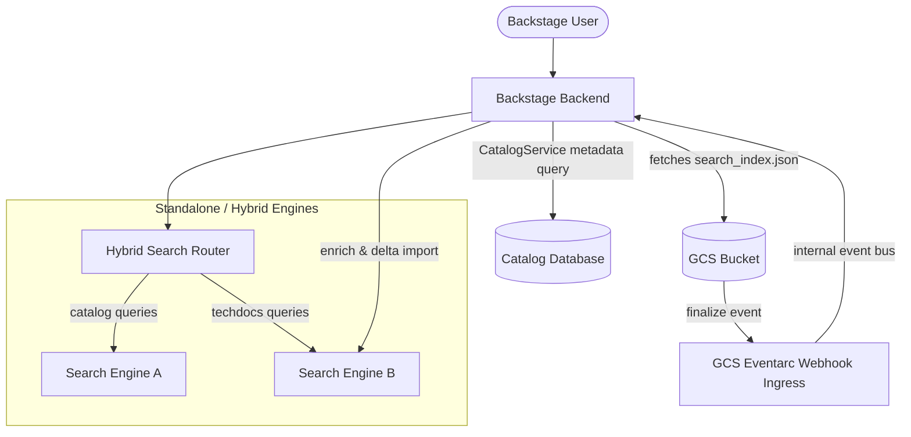
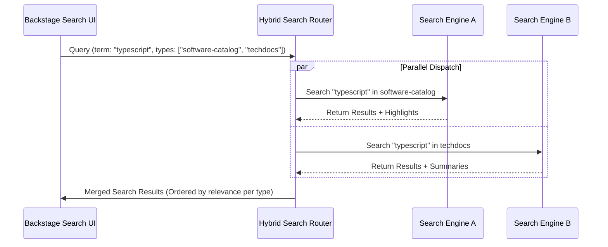
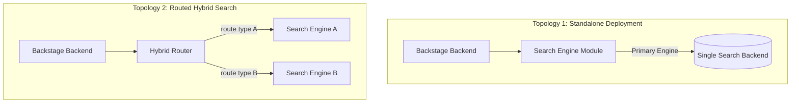
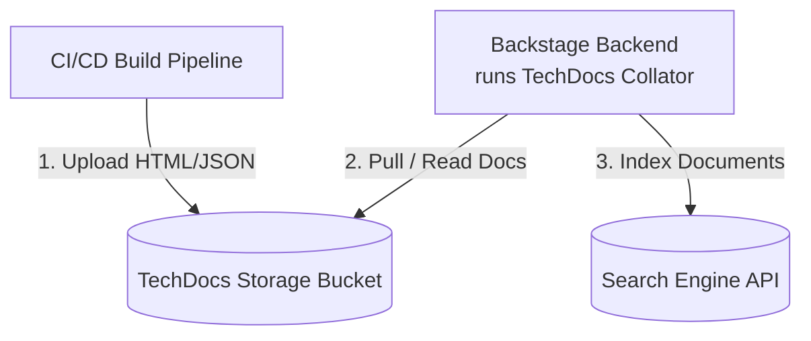
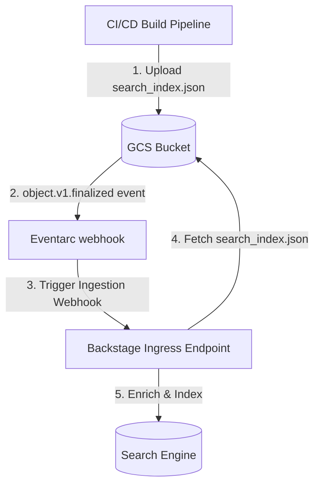
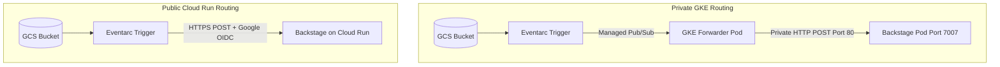
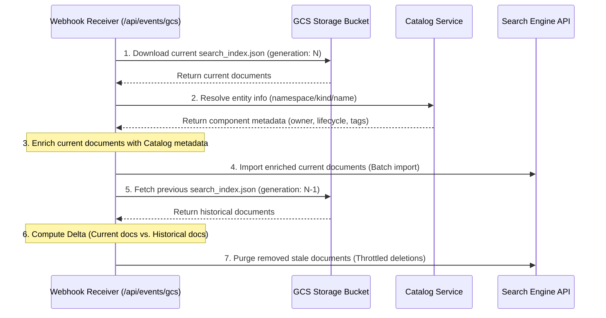

# Architecture & Design Explanation: Hybrid Search Workspace

This document provides a conceptual and architectural explanation of the **Hybrid Search Workspace**. It is designed for Backstage platform operators, system architects, and maintainers who want to understand the design decisions, component relationships, query routing paths, and ingestion topologies implemented across this workspace.

---

## 1. Introduction & High-Level System Architecture

### The Core Concept

When deploying search capabilities in a Backstage developer portal, operators manage different types of data indexes (such as component catalog entities, technical documentation pages, and team directories). Serving all of these search indexes through a single search engine backend can create performance, scaling, and cost bottlenecks.

The **Hybrid Search Workspace** implements a routed multi-engine search architecture. Instead of routing all search requests to a single backend, this system allows operators to distribute search query types across **multiple independent search engines** in parallel.

### Why Use Hybrid Search?

A hybrid search routing architecture provides several operational advantages:

1.  **Performance & Query Isolation**: Simple, fast keyword queries (e.g., database entity lookups) can be routed to a high-speed, low-latency engine. Heavy, resource-intensive document lookups (e.g., concept-based prose searching) can be routed to a semantic engine. Isolating these queries prevents resource starvation and keeps portal search responsive.
2.  **Granular Search Configurations**: Operators can define completely separate ranking parameters, text normalization rules, boosting factors, and indexing schemas for each document type, customizing the search experience for different content.
3.  **Infrastructure Decoupling**: Downstream search backends can be scaled, maintained, and configured independently. An outage or high load on one engine does not take down the search capabilities of other document categories.

### Workspace Component Relationships

The workspace consists of modular packages that decouple search querying, engine registration, and index ingestion:

---

## 2. Query Orchestration: The Hybrid Search Router

The query orchestration layer is implemented in the `@backstage-community/plugin-search-backend-module-hybrid` package. It acts as a query-routing proxy.

### Routing Architecture

The router registers itself to the Backstage Search Service as a primary search engine. When a query arrives, the router intercepts it and evaluates the requested `types` array:

1.  **Type Mapping**: The router inspects its configuration (`search.engines.hybrid.routing`) to map index types to specific configured search engine names.
2.  **Parallel Dispatch**: Rather than querying engines sequentially, the router dispatches requests to downstream engine modules in parallel using asynchronous JavaScript promises (`Promise.allSettled`).
3.  **Timeout Isolation**: If one search engine experiences a delay or outage, it does not block the entire search query. The router aggregates the successful results and ignores the failed engine's results, ensuring a resilient user experience.

### Result Merging & Metadata Preservation

Because different search engines return distinct response structures (such as matching word highlights or AI-generated answers), the router preserves these extensions. It appends the raw engine response attributes to the consolidated search response payload returned to the Backstage frontend, allowing the search UI to render rich search result cards dynamically.

---

## 3. Topology Options: Standalone vs. Routed Hybrid Deployments

The workspace is designed to be highly flexible, offering operators two main deployment topologies:

### 1. Standalone Mode

- **Concept**: A single search engine module is registered directly as the primary search engine for the portal. It handles all document types and queries.
- **Use Case**: Ideal for simpler deployments or teams that want to centralize search infrastructure on a single backend (e.g. running only Typesense or only Vertex AI Search).

### 2. Routed Hybrid Search Mode

- **Concept**: The Hybrid Search Router is registered as the primary search engine, delegating specific index types to different sub-engines behind the scenes.
- **Use Case**: Recommended for enterprise developer portals containing diverse content types that benefit from query isolation and specialized search backends.

---

## 4. TechDocs Ingestion Architectures

TechDocs generates static HTML pages via MkDocs. In order to search these documents, they must be parsed, chunked, and ingested into the search engine. This workspace supports two ingestion architectures:

### Option A: Standard Collator-Based Indexing (Synchronous Pull)

In this mode, the build pipeline compiles TechDocs and uploads the static files to a storage bucket (GCS). Backstage's search backend runs a scheduled indexing loop using the standard `DefaultTechDocsCollatorFactory`. This collator periodically downloads the compiled TechDocs files from the storage bucket, parses them, and indexes them into the search engine backend.

- **Advantages**:
  - Uses standard, built-in Backstage workflow patterns.
  - Simple deployment; requires no external cloud events or webhook listener configuration.
- **Disadvantages**:
  - **Scheduled Delay**: Indexing runs on a schedule, meaning search content updates are not real-time.
  - **Resource Usage**: Downloading and parsing HTML pages runs inside the Backstage backend process, causing periodic CPU and network spikes.

### Option B: Decoupled Ingestion Pipeline (Asynchronous Push)

This is the recommended production pattern for real-time, lightweight ingestion. The build pipeline compiles TechDocs, generates a `search_index.json` file, and uploads it to GCS. The upload triggers a GCS Eventarc finalized event, notifying the Backstage Webhook Receiver. Backstage immediately fetches the pre-built index file from GCS, enriches it, and pushes it to the search engine.

- **Advantages**:
  - **Build Isolation & Performance**: The heavy HTML parsing happens in the build job, keeping Backstage backend overhead minimal.
  - **Real-time Updates**: Search indices are updated instantly upon GCS upload.
  - **Catalog Metadata Enrichment**: Enables Backstage to query the Catalog Service to enrich index documents with entity catalog metadata (owner, lifecycle, tags) before indexing.
- **Disadvantages**:
  - Requires event routing infrastructure (GCP Eventarc and Pub/Sub) and setting up an external webhook receiver on the Backstage backend.

---

## 5. Webhook Ingress, Security & Delta Reconciliation

When running the **Decoupled Ingestion Pipeline (Option B)**, events are routed to Backstage via the `@backstage-community/plugin-events-backend-module-gcs-eventarc` package, mounting an ingress point at `/api/events/gcs`.

### Ingress Webhook Security Model

Depending on where Backstage is hosted, the webhook ingress point supports two distinct security models:

#### 1. Private GKE VPC Routing (No OIDC Validation)

- **Flow**: Eventarc triggers events privately via a cluster-local `gke-forwarder` pod deployed inside the cluster VPC. The forwarder pod privately subscribes to Eventarc's Google-managed Pub/Sub topic, pulls events, and posts them **internally** inside the VPC network directly to your GKE service: `http://backstage.backstage.svc.cluster.local/api/events/gcs`.
- **Security**: Since the traffic is internal to the VPC and does not pass through the public internet, Google OIDC token generation is not supported by the forwarder. Security must be enforced at the Kubernetes network layer using `NetworkPolicies` to ensure only traffic from the Eventarc managed namespace can hit Port `80` of the Backstage Pod.
- **Port 80 Constraint**: The GKE Eventarc destination service strictly routes to Port `80`. The Backstage Kubernetes Service must expose Port `80` and map it to target port `7007` (or your Backstage container port).

#### 2. Public Cloud Run / External Routing (Google OIDC Validation)

- **Flow**: Eventarc sends webhooks directly to the public HTTPS URL of your Backstage deployment (e.g. running on Cloud Run).
- **Security**: The ingress module intercepts requests and validates the `Authorization: Bearer <ID_TOKEN>` header using `google-auth-library`. It verifies the OIDC cryptographic signature, verifies that the issuer is `https://accounts.google.com`, confirms the audience matches the Backstage webhook endpoint, and verifies that the token belongs exclusively to the configured Eventarc trigger service account email.

### Catalog Enrichment & Delta Reconciliation

Once the webhook is successfully invoked, Backstage pulls the newly uploaded `search_index.json` from GCS and triggers an asynchronous delta-reconciliation pipeline:

1.  **Catalog Metadata Enrichment**: Backstage looks up the matching component entity in the Software Catalog using the `CatalogService` and appends catalog properties (`owner`, `lifecycle`, `componentType`, `annotations`) to each indexed document. This enables users to filter TechDocs search results by team owner or lifecycle stage.
2.  **Delta Calculation**: To prevent stale documents from remaining in the search engine index when pages are renamed or deleted in git, the engine computes a delta:
    - It fetches the current index file (generation `N`) and the previous historical index file (generation `N-1`) from GCS.
    - It extracts document URL paths from both.
    - Any document URL path present in the previous index but missing from the current index is flagged as stale.
3.  **Throttled Deletions**: Stale documents are deleted in parallel batches. To prevent API rate limit issues on the search engine endpoints, deletions are throttled using concurrent limits.

### Fail-Safe Ingress (Dead-Letter Topics)

Because Eventarc webhook requests are asynchronous HTTP requests, temporary network blips, Backstage server crashes, or database lockups can cause webhook deliveries to fail.

To ensure event reliability in production, a **Dead-Letter Topic (DLQ)** must be configured on the underlying Pub/Sub subscription managed by Eventarc. If Eventarc fails to deliver an event after its configured retry attempts, the message is automatically routed to a separate dead-letter topic where it is safely stored. This allows operators to inspect and debug failed events offline, preventing data loss during Backstage server outages.
