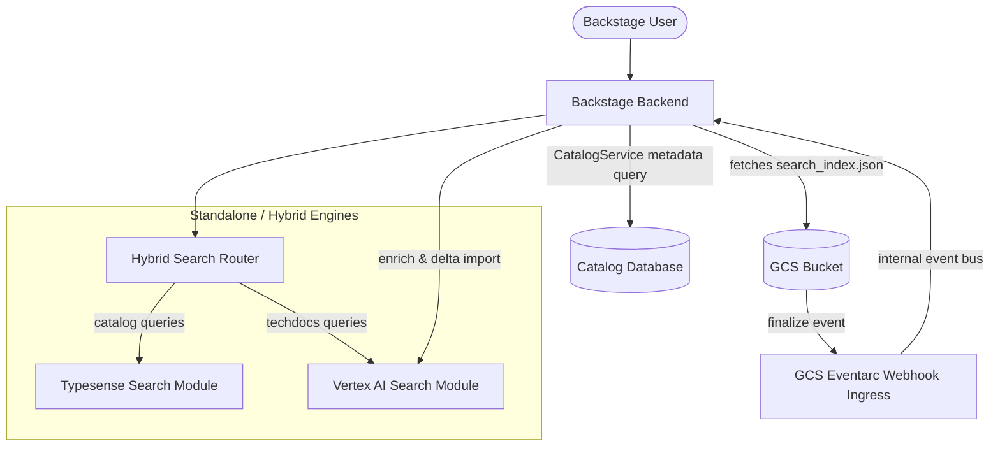
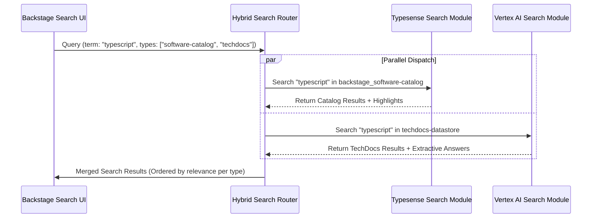
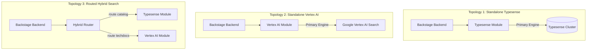
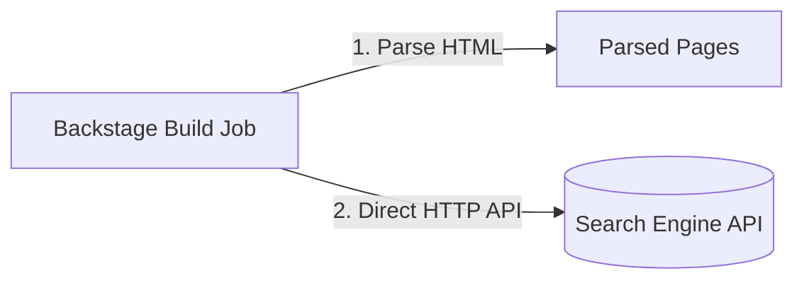
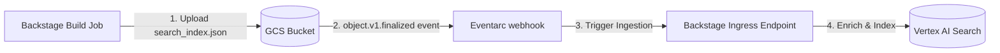
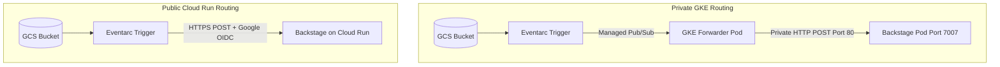
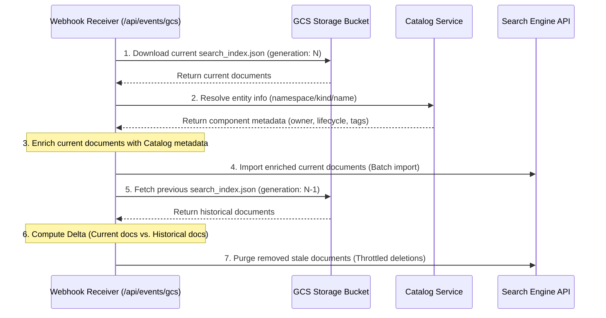

# Architecture & Design Explanation: Hybrid Search Workspace

This document provides a conceptual and architectural explanation of the **Hybrid Search Workspace**. It is designed for Backstage platform operators, system architects, and maintainers who want to understand the design decisions, component relationships, query routing paths, and ingestion topologies implemented across this workspace.

---

## 1. Introduction & High-Level System Architecture

### The Core Problem

When deploying search capabilities in a Backstage developer portal, operators face a classic trade-off between speed, accuracy, and cost:

1.  **Catalog/Keyword Search**: Backstage software catalogs contain highly structured entity metadata (component names, tags, owners, life-cycle stages). Queries are typically precise, keyword-driven lookup operations. For this task, a search engine needs to be **sub-millisecond fast**, support instant matching, and have low operational overhead.
2.  **Document/Semantic Search**: TechDocs, developer guides, and tutorials contain unstructured natural language prose. Traditional keyword search often fails here because users query concepts, not exact words. To solve this, **semantic/vector search** engines (which embed text using AI models to search concepts) are required.

Using a single search engine for both tasks results in compromised performance:

- Running **Vertex AI Search** directly for both catalog and techdocs works well for semantic parsing but introduces significant latency and cost overhead for simple keyword lookups in catalog data.
- Running **Typesense** or **Elasticsearch** is highly efficient for catalog queries, but lacks built-in semantic search capabilities out-of-the-box (unless complex vector pipelines are built and maintained manually).

### The Hybrid Solution

The **Hybrid Search Workspace** implements a routed multi-engine search architecture. It separates catalog lookup from semantic document retrieval by routing search types to dedicated engines:

- **Typesense** acts as the fast database engine for structured catalog search.
- **Vertex AI Search** acts as the semantic engine for TechDocs search.

### Workspace Component Relationships

The workspace consists of four modular packages that decouple search querying, engine registration, and index ingestion:

---

## 2. Query Orchestration: The Hybrid Search Router

The query orchestration layer is implemented in the `@backstage-community/plugin-search-backend-module-hybrid` package. It acts as an query-routing proxy.

### Routing Architecture

The router registers itself to the Backstage Search Service as a primary search engine. When a query arrives, the router intercepts it and evaluates the requested `types` array:

1.  **Type Mapping**: The router inspects its configuration (`search.engines.hybrid.routing`) to map index types to specific configured search engine names.
2.  **Parallel Dispatch**: Rather than querying engines sequentially, the router dispatches requests to downstream engine modules in parallel using asynchronous JavaScript promises (`Promise.allSettled`).
3.  **Timeout Isolation**: If one search engine experiences a delay or outage, it does not block the entire search query. The router aggregates the successful results and ignores the failed engine's results, ensuring a resilient user experience.

### Result Merging & Metadata Preservation

Because different search engines return distinct response structures (e.g., Typesense returns highlighted matching words, while Vertex AI Search returns AI-generated extractive answers and segments), the router preserves these extensions. It appends the raw engine response attributes to the consolidated search response payload returned to the Backstage frontend, allowing the search UI to render rich search result cards dynamically.

---

## 3. Topology Options: Standalone vs. Hybrid Deployments

The workspace is designed to be highly flexible, offering operators three main deployment topologies depending on their needs:

### 1. Standalone Typesense Mode

- **Use Case**: Ideal for small-to-medium deployments or teams looking for an open-source, low-latency, and cost-effective search solution.
- **Behavior**: Typesense handles all search index types. It provisions collections automatically using a wildcard regex schema `{ name: '.*', type: 'auto' }`.

### 2. Standalone Vertex AI Search Mode

- **Use Case**: Suitable for organizations that require natural language, conversational, or generative Q&A search capabilities across all content types in the portal.
- **Behavior**: Vertex AI Search acts as the single primary backend.

### 3. Routed Hybrid Search Mode

- **Use Case**: The recommended production pattern for enterprise developer portals.
- **Behavior**: Simple keyword search for catalog components is routed to Typesense, while semantic techdocs queries are routed to Vertex AI.

### Decision Matrix

| Metric                      | Standalone Typesense      | Standalone Vertex AI Search | Routed Hybrid Search           |
| :-------------------------- | :------------------------ | :-------------------------- | :----------------------------- |
| **Catalog Query Latency**   | Sub-millisecond (Fastest) | 100ms - 300ms               | Sub-millisecond                |
| **TechDocs Search Quality** | Keyword-only              | Semantic / Concept (Best)   | Semantic / Concept             |
| **GCP Cloud Cost**          | Zero (if self-hosted)     | High (per-query cost)       | Medium (only techdocs queries) |
| **Setup Complexity**        | Low                       | Medium                      | High                           |

---

## 4. TechDocs Ingestion Architectures

TechDocs generates static HTML pages via MkDocs. In order to search these documents, they must be parsed, chunked, and ingested into the search engine. This workspace supports two ingestion architectures:

### Option A: Direct Local Indexing (Synchronous)

In this mode, when a Backstage build pipeline compiles a TechDocs site, the local builder uses the search engine API client to send documents directly to the search engine.

- **Advantages**: Simple deployment; requires no cloud infrastructure or event routing setup.
- **Disadvantages**: Increases build pipeline execution time; coupling the build step directly to search engine API endpoints can create a bottleneck if the search engine experiences rate limits or downtime during a build.

### Option B: Decoupled Ingestion Pipeline (Asynchronous)

This is the recommended production pattern. The build step is fully decoupled from search engine APIs.

- **Advantages**:
  - **Build Isolation**: The techdocs build job only needs to write a `search_index.json` file to a GCS bucket and finishes instantly.
  - **Resilience**: Ingestion failures can be retried independently without failing the documentation build.
  - **Enrichment**: Enables Backstage to dynamically query the Catalog Service to enrich index documents with entity catalog metadata (such as Component owner, lifecycle, and team tags) before sending them to the search engine.

---

## 5. Webhook Ingress, Security & Delta Reconciliation

When running the **Decoupled Ingestion Pipeline (Option B)**, events are routed to Backstage via the `@backstage-community/plugin-events-backend-module-gcs-eventarc` package, mounting an ingress point at `/api/events/gcs`.

### Ingress Webhook Security Model

Depending on where Backstage is hosted, the webhook ingress point supports two distinct security models:

#### 1. Private GKE VPC Routing (No OIDC Validation)

- **Flow**: Eventarc triggers events privately via a cluster-local `gke-forwarder` pod deployed inside the cluster VPC. The forwarder pod privately subscribes to Eventarc's Google-managed Pub/Sub topic, pulls events, and posts them **internally** inside the VPC network directly to your GKE service: `http://backstage.backstage.svc.cluster.local/api/events/gcs`.
- **Security**: Since the traffic is internal to the VPC and does not pass through the public internet, Google OIDC token generation is not supported by the forwarder. Security must be enforced at the Kubernetes network layer using `NetworkPolicies` to ensure only traffic from the Eventarc managed namespace can hit Port `80` of the Backstage Pod.
- **Port 80 Constraint**: The GKE Eventarc destination service strictly routes to Port `80`. The Backstage Kubernetes Service must expose Port `80` and map it to target port `7007` (or your Backstage container port).

#### 2. Public Cloud Run / External Routing (Google OIDC Validation)

- **Flow**: Eventarc sends webhooks directly to the public HTTPS URL of your Backstage deployment (e.g. running on Cloud Run).
- **Security**: The ingress module intercepts requests and validates the `Authorization: Bearer <ID_TOKEN>` header using `google-auth-library`. It verifies the OIDC cryptographic signature, verifies that the issuer is `https://accounts.google.com`, confirms the audience matches the Backstage webhook endpoint, and verifies that the token belongs exclusively to the configured Eventarc trigger service account email.

### Catalog Enrichment & Delta Reconciliation

Once the webhook is successfully invoked, Backstage pulls the newly uploaded `search_index.json` from GCS and triggers an asynchronous delta-reconciliation pipeline:

1.  **Catalog Metadata Enrichment**: Backstage looks up the matching component entity in the Software Catalog using the `CatalogService` and appends catalog properties (`owner`, `lifecycle`, `componentType`, `annotations`) to each indexed document. This enables users to filter TechDocs search results by team owner or lifecycle stage.
2.  **Delta Calculation**: To prevent stale documents from remaining in the search engine index when pages are renamed or deleted in git, the engine computes a delta:
    - It fetches the current index file (generation `N`) and the previous historical index file (generation `N-1`) from GCS.
    - It extracts document URL paths from both.
    - Any document URL path present in the previous index but missing from the current index is flagged as stale.
3.  **Throttled Deletions**: Stale documents are deleted in parallel batches. To prevent API rate limit issues on the search engine endpoints, deletions are throttled using concurrent limits.

### Fail-Safe Ingress (Dead-Letter Topics)

Because Eventarc webhook requests are asynchronous HTTP requests, temporary network blips, Backstage server crashes, or database lockups can cause webhook deliveries to fail.

To ensure event reliability in production, a **Dead-Letter Topic (DLQ)** must be configured on the underlying Pub/Sub subscription managed by Eventarc. If Eventarc fails to deliver an event after its configured retry attempts, the message is automatically routed to a separate dead-letter topic where it is safely stored. This allows operators to inspect and debug failed events offline, preventing data loss during Backstage server outages.
