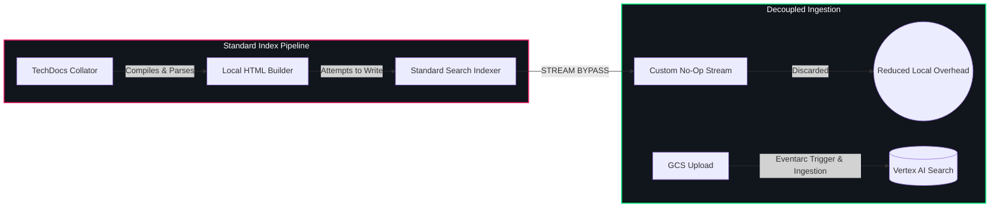

# Vertex AI Search Backend Module for Backstage (`@backstage-community/plugin-search-backend-module-vertexai`)

This backend module integrates Google Cloud Vertex AI Search capabilities into Backstage Search. It can be deployed as a standalone search engine or registered to the `@backstage-community/plugin-search-backend-module-hybrid` router to handle queries alongside other engines.

## Core Features

- **Decoupled Semantic Querying**: Routes Backstage search requests to Vertex AI Search Apps and Data Stores, utilizing semantic search, spellcheck, autocomplete, and search answers.
- **Direct Local Indexing (Optional)**: Allows standard Backstage search collator tasks (such as the Catalog collator) to index documents directly into Vertex AI Search. The module buffers and batches document objects during Backstage's scheduled indexing runs and sends them to the Vertex AI Search API. This is the default mechanism for indexing dynamic metadata like catalog entities.
- **Custom Type Mapping**: Maps Backstage document types (such as `techdocs`, `software-catalog`, or custom types) to dedicated Google Cloud Data Stores and Search Apps in the configuration.
- **Catalog Cleanup Sweeper**: Runs a background task to delete orphaned documentation assets from Google Cloud Storage (GCS) and Vertex AI Search when catalog entities are removed.
  > [!IMPORTANT] > **Sweeper Ingestion Dependency**: The cleanup sweeper task is only active when direct local indexing is disabled (`indexing.enabled = false`). If local indexing is enabled, catalog synchronization and deletions are handled by standard Backstage collator schedules.
  >
  > **Startup Delay**: To prevent race conditions where active files are deleted during startup before the catalog has finished bootstrapping, the sweeper incorporates a startup delay (defaults to 2 minutes) before starting its first sweep.

---

## TechDocs Ingestion Architecture & Modes

By default, standard Backstage installations parse and index TechDocs locally on the Node.js server. This module supports two ingestion modes depending on your requirements:

### Option A: Direct Local Indexing (Standard Backstage Flow)

In this mode, standard Backstage collators build and parse HTML files locally on your Node.js server and stream them directly to the Vertex AI Search API.

- **When to use**: Simpler setups or local development.
- **Configuration**: Set `indexing.enabled: true` in your configuration under `vertexai`.
- **Requirements**: No additional companion plugins or specific storage publishers are required.

---

### Option B: Decoupled Ingestion Pipeline (Recommended for Production)

In this mode, local document building and parsing are bypassed on the Node.js server. Instead, documentation is built in CI/CD, published to GCS, and ingested into Vertex AI Search via Eventarc.



#### How it Works:

1. **Bypass Stream**: The standard indexer returns a throwaway no-op stream, bypassing local document parsing.
2. **Decoupled Ingestion**: Documentation builds publish `search_index.json` to GCS. This upload triggers an Eventarc webhook that parses the manifest and imports pages to Vertex AI Search (see the [gcs-eventarc plugin](../events-backend-module-gcs-eventarc/README.md)).

#### Requirements & Setup:

- **Configuration Settings (`app-config.yaml`)**:
  - `techdocs.publisher.type` must be set to `googleGcs`.
  - `techdocs.publisher.googleGcs.bucketName` must be set to your GCS bucket name.
- **Package Dependencies (`package.json`)**:
  - **`@backstage-community/plugin-events-backend-module-gcs-eventarc`** (Required): Webhook receiver that listens for GCS bucket upload events.
  - **`@backstage/plugin-search-backend-module-techdocs`** (Required): The standard collator must be present so that the Vertex AI module can intercept its indexing stream.

---

## Installation

First, install the package in your Backstage backend package:

```bash
yarn --cwd packages/backend add @backstage-community/plugin-search-backend-module-vertexai
```

This package exports two backend modules depending on your search architecture:

### 1. Standalone Search Engine Setup

If you want Vertex AI Search to act as the primary, standalone search engine for your entire Backstage portal (default export):

```typescript
// packages/backend/src/index.ts
import { createBackend } from '@backstage/backend-defaults';

const backend = createBackend();

// Registers Vertex AI directly as the primary search engine (default export)
backend.add(
  import('@backstage-community/plugin-search-backend-module-vertexai'),
);

backend.start();
```

### 2. Hybrid Search Engine Router Setup

If you are running the custom Hybrid Search Router (routing queries to different engines like Typesense for catalog and Vertex AI for techdocs in parallel), you must register the hybrid named export:

```typescript
// packages/backend/src/index.ts
import { createBackend } from '@backstage/backend-defaults';

const backend = createBackend();

// 1. Add the Hybrid Search router orchestrator
backend.add(import('@backstage-community/plugin-search-backend-module-hybrid'));

// 2. Add Vertex AI registered to the hybrid search registry
backend.add(
  import('@backstage-community/plugin-search-backend-module-vertexai/hybrid'),
);

// 3. Add Typesense registered to the hybrid search registry
backend.add(
  import('@backstage-community/plugin-search-backend-module-typesense/hybrid'),
);

backend.start();
```

---

## Extractive Content & Snippet Priority

When displaying search previews, this engine translates Vertex AI's response structures into the Backstage `text` field using a priority-ordered extraction hierarchy:

1. **Extractive Answers** (Highest Priority): Direct, precise sentences answering natural language queries (e.g. `"The default port is 7007."`). Multiple answers are joined using spaces (`' '`) to read as a single paragraph.
2. **Extractive Segments** (Medium Priority): Context paragraphs containing the match. Multiple segments from non-contiguous parts of the document are joined with newlines and ellipses (`\n...\n`).
3. **Snippets** (Lowest Priority): Text fragments containing the highlighted search terms.
4. **Fallback Text**: The raw, full body text of the indexed document page.

### How to Enable in `app-config.yaml`

To use extractive answers and segments, the Vertex AI Search application must be configured on the Enterprise Edition tier in Google Cloud. Configure the `extractiveContentSpec` block within `searchOptions`:

```yaml
search:
  engines:
    vertexai:
      types:
        techdocs:
          datastore:
            projectId: ${projectId}
            datastoreId: ${dataStoreId}
            location: ${location}
          engine:
            projectId: ${projectId}
            engineId: ${engineId}
            location: ${location}
          searchOptions:
            contentSearchSpec:
              extractiveContentSpec:
                maxExtractiveAnswerCount: 1
                maxExtractiveSegmentCount: 2
              snippetSpec:
                maxSnippetCount: 1
```

---

## Configuration

Configure the Google Cloud Vertex AI Search settings in your `app-config.yaml`. By default, local indexing is bypassed. Direct local indexing can be enabled for streaming assets like Catalog entities directly to Vertex AI Search.

> [!IMPORTANT] > **Catalog Indexing Force-Enabled**:
> Indexing for the `software-catalog` type is mandatory. Configuration settings attempting to disable it globally or specifically will be ignored, and backend initialization will override the setting to enabled with a log warning.

### The `blendedSearch` Config Block

The `blendedSearch` configuration block determines how Vertex AI Search queries multiple datastores simultaneously. All three keys are required inside this block:

- **`projectId`** (string): The Google Cloud Project ID where the global blended search app is located.
- **`location`** (string): The geographic region/location of the global blended search app (e.g., `global`, `europe-west4`).
- **`engineId`** (string): The global blended search App Engine ID.

> [!WARNING] > **Blended Search Conflict in Hybrid Setup**:
> Configure `blendedSearch` only when using Vertex AI Search in Standalone mode.
>
> In a Hybrid Search Router setup, global query blending is managed by the Backstage Hybrid Search Router itself. Specifying `blendedSearch` in Hybrid mode will result in a configuration conflict error.

> [!NOTE] > **No Relevance Scores in Blended App Response**:
> When querying a global `blendedSearch` App (via `engineId`), the Google Cloud Discovery Engine API merges results from all underlying datastores but does not return a `relevanceScore` in the response hits. As a result, the `score` field in the final search results will be returned as `null` or `undefined` for blended matches. Querying individual datastores directly returns numerical scores.

---

### 1. Standalone Search Engine Configuration

Configure this block when Vertex AI Search is the primary search engine for Backstage. The `blendedSearch` block is required to query multiple datastores:

```yaml
search:
  engine: vertexai
  engines:
    vertexai:
      # MANDATORY: Global blended Search App for homepage queries
      blendedSearch:
        projectId: company-portal-prod
        location: europe-west4
        engineId: backstage-global-search-app
        # Optional raw search query configurations (e.g., extractive content options)
        searchOptions:
          contentSearchSpec:
            extractiveContentSpec:
              maxExtractiveAnswerCount: 1
              maxExtractiveSegmentCount: 2
            snippetSpec:
              maxSnippetCount: 1

      # Optional: Global default for direct local indexing streams
      indexing:
        enabled: true

      # Mapping of Backstage search types to Vertex AI data stores and engines
      types:
        techdocs:
          datastore:
            projectId: company-core-prod
            datastoreId: backstage-techdocs
            location: europe-west4
          # Optional: Dedicated serving Engine App for techdocs-specific queries (falls back to datastore if omitted)
        software-catalog:
          datastore:
            projectId: company-catalog-prod
            datastoreId: backstage-catalog
            location: europe-west4
          # Inherits global default (indexing.enabled: true)

      # Configurable catalog cleanup task
      cleanup:
        enabled: true
        frequency: { hours: 2 } # optional, defaults to 2 hours
        initialDelay: { minutes: 2 } # optional, defaults to 2 minutes (avoids race conditions during catalog bootstrap)

techdocs:
  publisher:
    googleGcs:
      bucketName: my-techdocs-bucket
```

---

### 2. Hybrid Search Engine Configuration

Use this configuration if you are using the Hybrid Search Router and delegating different index types to different engines (e.g., `techdocs` to `vertexai` and `software-catalog` to `typesense`).

The `blendedSearch` block is omitted because query blending is managed by the Hybrid Search Router, and Vertex AI Search queries its type-specific datastore directly:

```yaml
search:
  engine: hybrid
  engines:
    hybrid:
      routing:
        techdocs: vertexai
        software-catalog: typesense
        default: typesense
    vertexai:
      # Mapping of Backstage search types to Vertex AI data stores and engines
      types:
        techdocs:
          datastore:
            projectId: company-core-prod
            datastoreId: backstage-techdocs
            location: europe-west4
          # Omit engine config because TechDocs datastore is queried directly, or map to a dedicated techdocs engine:
          engine:
            projectId: company-portal-prod
            engineId: backstage-techdocs-app
            location: europe-west4
          # Disable local indexing for TechDocs because it is indexed via Eventarc
          indexing:
            enabled: false

      cleanup:
        enabled: true
        frequency: { hours: 2 }
        initialDelay: { minutes: 2 }

techdocs:
  publisher:
    googleGcs:
      bucketName: my-techdocs-bucket
```

---

## Bulk-Bootstrapping Existing TechDocs (`bootstrap.ts`)

If you are migrating an existing Backstage instance to Vertex AI Search, you can run the provided CLI bootstrap script to import existing documentation from Google Cloud Storage into the Vertex AI Search Datastore.

The script runs in two steps:

1. **`prepare-docs`**: Scans the source TechDocs GCS bucket for `search_index.json` files, downloads/parses them, fetches metadata from the running Backstage catalog API to enrich the documents with owner/lifecycle annotations, maps them to the required Vertex AI structured schema, and uploads them to a staging GCS bucket as `.ndjson` files.
2. **`import-docs`**: Batches and imports those staging `.ndjson` files into the Vertex AI Search Datastore using the GCP Discovery Engine API.

> [!IMPORTANT] > **Staging GCS Bucket Requirement**:
> Before running the script, create a separate, empty Google Cloud Storage bucket (e.g., `your-temporary-staging-gcs-bucket`) to serve as a staging area. The script outputs flat structured NDJSON files into this bucket, which are subsequently read by the Discovery Engine API during the import step.

### How to Run:

#### 1. Prepare Staging Files

Run the preparation command, pointing it to your source TechDocs bucket, a staging bucket, and your running Backstage API (to query catalog metadata):

```bash
npx ts-node plugins/search-backend-module-vertexai/scripts/bootstrap.ts prepare-docs \
  --techdocsBucket <your-techdocs-gcs-bucket> \
  --stagingBucket <your-temporary-staging-gcs-bucket> \
  --backstageUrl <http://localhost:7007 or your-backstage-endpoint>
```

#### 2. Trigger Vertex AI Import

Import the staging files directly into your Vertex AI Datastore. The script automatically chunks the import requests into batches of 100 files to avoid Discovery Engine limits:

```bash
npx ts-node plugins/search-backend-module-vertexai/scripts/bootstrap.ts import-docs \
  --projectId <your-gcp-project-id> \
  --location <eu or global> \
  --datastoreId <your-techdocs-datastore-id> \
  --stagingBucket <your-temporary-staging-gcs-bucket>
```

---

## Infrastructure Provisioning (Terraform)

To run Vertex AI Search, provision one separate Data Store for each Backstage document type (e.g., one for `software-catalog`, one for `techdocs`, etc.). For global portal-wide searches, you link all of these Data Stores to a single global blended Search App. Optionally, you can also provision additional dedicated Search Apps for individual Data Stores to support custom search configs and query tuning for specific types.

### Blended App and Multi-Datastore Layout

This configuration provides the following benefits:

1. **Isolated Search Tuning**: Allows you to customize search settings and behavior differently in every Data Store.
2. **Unified Search Results**: By linking all Data Stores to a single Search App, Vertex AI Search queries all linked data stores and returns a blended, ranked results list.
3. **Isolated Schemas**: Keeps schemas clean and separate for each document type, avoiding mixing unrelated fields in a single index.
4. **Geographical Flexibility**: You can house different Data Stores in different geographic regions (e.g. storing EU catalog data in Europe and US docs in the US) while still querying both from a single global app.

To simplify configuration, the setup uses semi-dynamic schema discovery:

- The core `title` and `text` (description) key property mappings are defined in schemas to ensure optimal search relevancy.
- **Filtering Fields Requirement**: Any fields that you intend to use in query filters (such as `kind`, `namespace`, `location`, `owner`, `lifecycle`, or `componentType`) must be explicitly declared in the schema properties block and marked as `"indexable": true`.
- Setting `"dynamic": "true"` in the JSON schema properties instructs Google Cloud to automatically discover and store other metadata fields on-the-fly when documents are ingested.

### Standalone Semi-Dynamic JSON Schema

This JSON Schema blueprint serves as a template for your TechDocs and Software Catalog Data Stores. For other custom document types, keep the core `title` and `text` properties (mapped for search relevance), and determine which additional fields will be used in your query filters to declare them explicitly as both `"indexable": true` and `"retrievable": true`.

```json
{
  "$schema": "https://json-schema.org/draft/2020-12/schema",
  "type": "object",
  "dynamic": "true",
  "properties": {
    "title": {
      "type": "string",
      "keyPropertyMapping": "title",
      "retrievable": true
    },
    "text": {
      "type": "string",
      "keyPropertyMapping": "description",
      "retrievable": true
    },
    "kind": {
      "type": "string",
      "indexable": true,
      "retrievable": true
    },
    "namespace": {
      "type": "string",
      "indexable": true,
      "retrievable": true
    },
    "location": {
      "type": "string",
      "indexable": true,
      "retrievable": true
    },
    "owner": {
      "type": "string",
      "indexable": true,
      "retrievable": true
    },
    "lifecycle": {
      "type": "string",
      "indexable": true,
      "retrievable": true
    },
    "componentType": {
      "type": "string",
      "indexable": true,
      "retrievable": true
    }
  }
}
```

### Required Google Cloud APIs

Before provisioning, ensure the following service APIs are enabled on your GCP project:

- **`discoveryengine.googleapis.com`** (Vertex AI Agent Builder / Search API)
- **`cloudresourcemanager.googleapis.com`** (Cloud Resource Manager API, required for IAM policy configuration)

### Terraform Resource Blueprint

Use the following Terraform manifest to provision your multi-datastore blended Search App:

```hcl
locals {
  # Define all Backstage document categories/types you wish to index in your portal
  datastores = {
    techdocs = {
      display_name         = "Backstage TechDocs Store"
      create_dedicated_app = true  # <--- Triggers a dedicated Search App just for TechDocs!
    }
    catalog = {
      display_name         = "Backstage Catalog Store"
      create_dedicated_app = false # Uses only the global blended Search App
    }
  }
}

# ============================================================================
# 1. DYNAMIC DATA STORES
# ============================================================================

resource "google_discovery_engine_data_store" "backstage" {
  for_each          = local.datastores
  project           = var.project_id
  location          = var.region
  data_store_id     = "backstage-${each.key}"
  display_name      = each.value.display_name
  industry_vertical = "GENERIC"
  content_config    = "NO_CONTENT" # Ingested directly in-memory via JSON
  solution_types    = ["SOLUTION_TYPE_SEARCH"]
}

# ============================================================================
# 2. SEMI-DYNAMIC SCHEMAS (Auto-Discovery Enabled)
# ============================================================================

resource "google_discovery_engine_schema" "backstage_schema" {
  for_each      = local.datastores
  project       = var.project_id
  location      = google_discovery_engine_data_store.backstage[each.key].location
  data_store_id = google_discovery_engine_data_store.backstage[each.key].data_store_id
  schema_id     = "default_schema"

  # Standardized schema template for TechDocs and Software Catalog (explicitly maps core & filterable fields)
  json_schema = jsonencode({
    "$schema": "https://json-schema.org/draft/2020-12/schema",
    "type": "object",
    "dynamic": "true",
    "properties": {
      "title":         { "type": "string", "keyPropertyMapping": "title", "retrievable": true },
      "text":          { "type": "string", "keyPropertyMapping": "description", "retrievable": true },
      "kind":          { "type": "string", "indexable": true, "retrievable": true },
      "namespace":     { "type": "string", "indexable": true, "retrievable": true },
      "location":      { "type": "string", "indexable": true, "retrievable": true },
      "owner":         { "type": "string", "indexable": true, "retrievable": true },
      "lifecycle":     { "type": "string", "indexable": true, "retrievable": true },
      "componentType": { "type": "string", "indexable": true, "retrievable": true }
    }
  })
}

# ============================================================================
# 3. OPTIONAL DEDICATED SEARCH APPS (Per Data Store)
# ============================================================================

resource "google_discovery_engine_app" "dedicated" {
  # Filters the datastores map to only loop over those that explicitly requested a dedicated app!
  for_each          = { for k, v in local.datastores : k => v if lookup(v, "create_dedicated_app", false) }
  project           = var.project_id
  location          = var.region
  collection_id     = "default_collection"
  app_id            = "backstage-${each.key}-search"
  display_name      = "Backstage ${each.value.display_name} App"
  industry_vertical = "GENERIC"
  solution_type     = "SOLUTION_TYPE_SEARCH"

  # Links ONLY the corresponding Data Store to this dedicated Search App
  data_store_ids    = [google_discovery_engine_data_store.backstage[each.key].data_store_id]
}

# ============================================================================
# 4. GLOBAL BLENDED SEARCH APP (Linking All Data Stores)
# ============================================================================

resource "google_discovery_engine_app" "backstage_search" {
  project           = var.project_id
  location          = var.region
  collection_id     = "default_collection"
  app_id            = "backstage-search"
  display_name      = "Backstage Global Search App"
  industry_vertical = "GENERIC"
  solution_type     = "SOLUTION_TYPE_SEARCH"

  # Automatically resolves and links all dynamically provisioned Data Stores
  data_store_ids    = [for ds in google_discovery_engine_data_store.backstage : ds.data_store_id]
}
```

> [!IMPORTANT] > **GCP Service Account IAM Requirements**:
> The Service Account used by your Backstage backend must have:
>
> 1. **`roles/discoveryengine.admin`** on the GCP project or Discovery Engine resource. _(Note: Admin permission is strictly required; lower-tier editor/viewer roles will fail to purge/delete indexed documents)._
> 2. **`roles/storage.objectAdmin`** on the TechDocs GCS bucket to scan for and delete orphaned static folders.
